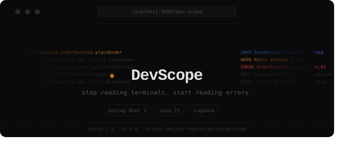

<div style="text-align: center;">
  
</div>

# DevScope internals

Notes on how DevScope works, for anyone reading or changing the code. For usage see [README.md](README.md).

## The problem, technically

When a controller throws:

1. Your code throws `OrderServiceException: Could not process order`
2. `DispatcherServlet` wraps it in a `ServletException` and logs it, but attaches the **root cause** to the log event
3. The terminal shows `IOException: Socket timed out` as the headline

So anything that only listens to Logback gets the wrong exception. DevScope grabs it before that happens.

## Packages

```
com.devscope
├── model/          ErrorEvent, LogEntry, StackFrame (plain POJOs, serialized as-is)
├── store/          ErrorEventStore, the in-memory ring buffers
├── appender/       DevScopeAppender + DevScopeAppenderLifecycle (log lines)
├── web/            ErrorCapture, DevScopeRequestFilter, DevScopeExceptionResolver,
│                   DevScopeController (API), DevScopeUiController (page + health)
└── autoconfigure/  DevScopeAutoConfiguration, DevScopeUiAutoConfiguration, DevScopeProperties
```

## How data gets in

```
log call anywhere in the app
  -> DevScopeAppender.append() -> LogEntry -> store

controller throws
  -> DevScopeExceptionResolver (runs first, returns null so the app's handlers still run)
       -> ErrorCapture.capture()
  -> if nobody handled it: DevScopeRequestFilter catches it, rethrows
       -> ErrorCapture.capture()   (same instance, skipped)
```

The UI polls `/stats`, `/errors` and `/logs` every 3 seconds.

### Two entry points for exceptions

The filter alone misses anything an `@ExceptionHandler` / `@ControllerAdvice` handles, because those exceptions never leave the DispatcherServlet. The resolver alone misses exceptions thrown outside Spring MVC (in other filters, for example). So both feed into `ErrorCapture`, which keeps a weak identity set of exceptions it already stored. One exception, one entry.

### Why the appender doesn't capture exceptions

That was the first design. It broke on the root-cause problem above. The appender stayed for log lines, where there's no such problem.

## ErrorEventStore

Two `ArrayDeque`s with a max size each. When full, the oldest entry is dropped before the new one is added, so memory is flat however long the app runs.

`ReentrantReadWriteLock`: many readers at once (UI polling), writes exclusive. Unlocks are always in `finally`.

`addError` rejects the same exception class + message on the same thread within 500ms. The servlet container can send an error request through the filter chain a second time.

## ErrorCapture

1. Unwraps `ServletException` / `NestedServletException` / `InvocationTargetException` to get the exception the app threw
2. Skips Spring infrastructure exceptions (404s, wrong method, bad params): not bugs, just noise
3. Parses frames, marks a frame as an app frame when its class starts with `devscope.base-package`
4. Walks `getCause()` in a loop to build the cause chain
5. Attaches the last 20 log lines from the current thread

`appFrame` drives most of the UI: the highlighting, the collapsed framework frames, and the per-layer counts. That's why `base-package` matters. Too broad (`com`) and framework classes light up, too narrow (`...controllers`) and your service layer looks like framework.

## DevScopeAppender

`AppenderBase<ILoggingEvent>`. `append()` runs on the app thread for every log call, so it only builds a `LogEntry` and writes it. No I/O, no parsing.

`DevScopeAppenderLifecycle` attaches it to the ROOT logger in `@PostConstruct` (so every logger in the app goes through it) and detaches it in `@PreDestroy`, so devtools restarts don't stack appenders. It's a separate bean because a `@PostConstruct` on the `@Configuration` class that uses its own `@Bean` methods is a cycle Spring Boot 3 won't start with.

## Auto-configuration

Both classes are listed in `META-INF/spring/org.springframework.boot.autoconfigure.AutoConfiguration.imports`.

- `DevScopeAutoConfiguration`: servlet web app + `devscope.enabled=true`. Registers the store, ErrorCapture, filter (order -1), resolver, API controller and appender lifecycle.
- `DevScopeUiAutoConfiguration`: any servlet web app, enabled or not. Registers only the UI controller, so `/dev-scope` never becomes an unmapped path that ends up as an ERROR in the consumer's logs. `/dev-scope/health` returns 503 when disabled and the UI stops polling.

## The UI

One vanilla HTML/CSS/JS file at `META-INF/resources/dev-scope/index.html`. Polls with `Promise.all`. The detail drawer is built once per click and only its timestamp updates on later polls, so expanded/collapsed state and scroll position survive the refresh.

## Known limitations

- **Correlated logs are best effort.** Same thread doesn't strictly mean same request, since Tomcat reuses threads, so a line from the previous request on that thread can show up.
- **In-memory only.** Gone on restart, on purpose. This is a dev tool, not monitoring.
- **One base package.** Multi-package support is planned.

## Adding something to the UI

1. Add the field to the model (`ErrorEvent`, `LogEntry` or `StackFrame`)
2. Fill it in `ErrorCapture` (errors) or `DevScopeAppender` (logs)
3. The controller serializes models directly, nothing to change there
4. Render it in `index.html`

## Tests

`mvn verify`. Unit tests for the store, ErrorCapture and filter, `ApplicationContextRunner` tests for the auto-config conditions, and an integration test (`com.example.demo`) that boots a small app with a `@ControllerAdvice` and checks handled and unhandled exceptions end up in the store once each.
