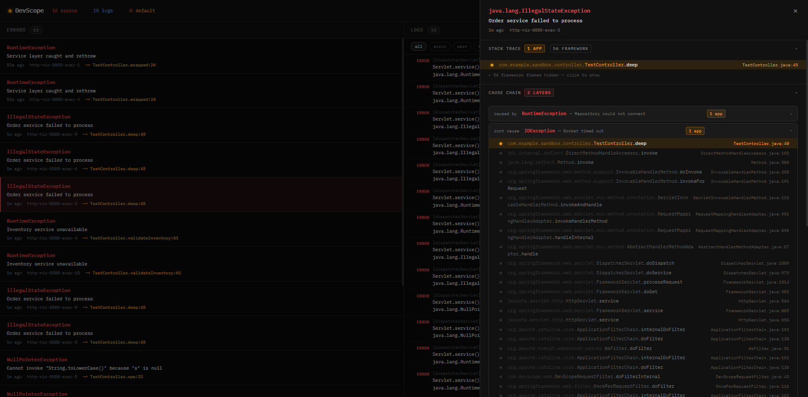

# DevScope

[](https://github.com/SeaumSiddiqui/DevScope/actions/workflows/build.yml)
[](https://jitpack.io/#SeaumSiddiqui/DevScope)

A Spring Boot library that shows your app's errors in a web page at `/dev-scope`, with your own code highlighted and the logs that led to each error attached. One dependency, two properties, nothing else to set up.



## Why

One exception in Spring Boot prints 50+ lines in the terminal, most of it framework code. On top of that, the headline is often the wrong exception: Spring logs the root cause, not the exception your code actually threw. Finding your line and the log lines around it is manual work every time.

DevScope catches the exception before Spring touches it, keeps the full "Caused by" chain, and puts it in a UI where framework frames are collapsed and your frames stand out.

## Install

Add the JitPack repository and the dependency to your `pom.xml`:

```xml
<repositories>
    <repository>
        <id>jitpack.io</id>
        <url>https://jitpack.io</url>
    </repository>
</repositories>

<dependency>
    <groupId>com.github.SeaumSiddiqui</groupId>
    <artifactId>DevScope</artifactId>
    <version>v0.1.0</version>
</dependency>
```

Turn it on for your dev profile only, in `application-dev.properties`:

```properties
devscope.enabled=true
devscope.base-package=com.example.yourapp
```

Start the app and open `http://localhost:8080/dev-scope`.

DevScope is **off by default**. The UI and API have no authentication and show your logs, so keep it out of production.

## Configuration

| Property | Default | Description |
|---|---|---|
| `devscope.enabled` | `false` | Turns DevScope on. |
| `devscope.base-package` | `""` | Root package of your code, e.g. `com.example.myapp`. Frames from this package are highlighted, everything else is collapsed. |
| `devscope.max-errors` | `200` | Errors kept in memory. Oldest is dropped when full. |
| `devscope.max-logs` | `1000` | Log lines kept in memory. |

## What you get

- **Error feed**: every exception, newest first, with class, message, time, thread and the line in your code where it started.
- **Handled exceptions too**: exceptions your `@ControllerAdvice` turns into a nice response are captured as well, and the response stays exactly the same.
- **Stack trace viewer**: your frames highlighted, Spring/JDK frames collapsed behind a toggle.
- **Cause chain**: each "Caused by" layer is its own collapsible block.
- **Correlated logs**: the log lines from the same request thread right before the error.
- **Live log stream**: all log lines with ERROR / WARN / INFO / DEBUG filters.
- **Active profile** in the header.

## API

The UI uses these, you can call them too:

```
GET     /dev-scope/api/errors            all errors, newest first
GET     /dev-scope/api/errors/{id}       one error
GET     /dev-scope/api/logs?level=ERROR  logs, level is optional
GET     /dev-scope/api/stats             counts + active profiles
DELETE  /dev-scope/api/clear             wipe everything
```

## Safety

- In-memory only. Nothing is written to disk and nothing leaves the process.
- Fixed memory: both stores are ring buffers with a max size.
- Never changes your app's behaviour: exceptions are always rethrown or passed on.
- Only active in servlet web apps. In a batch job or CLI app it does nothing.

## Requirements

- Java 17+
- Spring Boot 3.x
- An embedded servlet server (Tomcat, Jetty or Undertow)

## Contributing

How it works under the hood is in [INTERNALS.md](INTERNALS.md). Run the tests with `mvn verify`.
